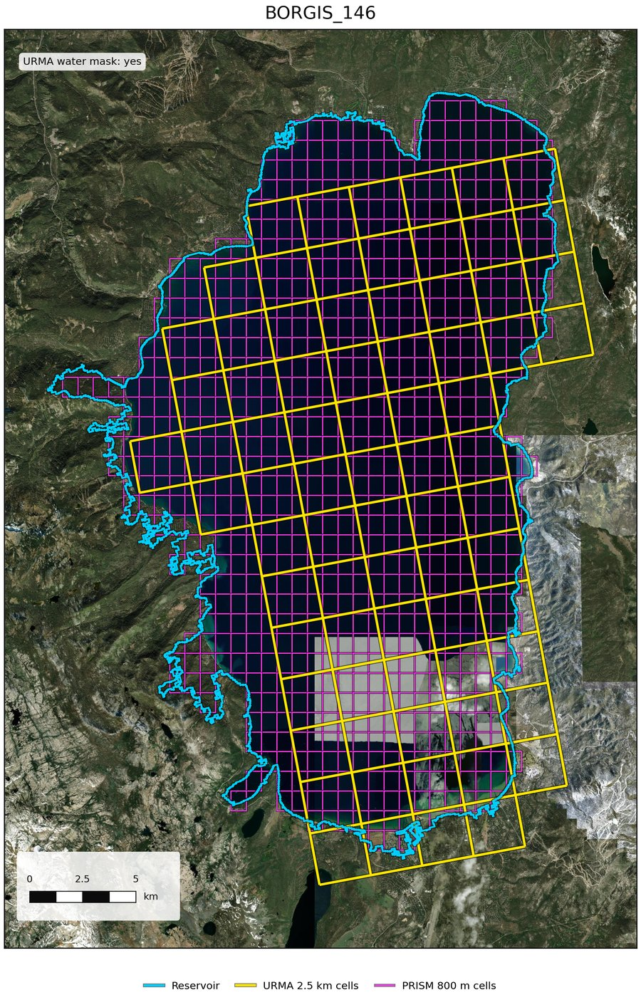

# resdlem-force

This package is designed to run with resdlem. This package streamlines the cell geometry selection and the extraction of URMA and PRISM data from earth engine for running the dlem model.

## Install

```bash
pip install resdlem-force
```

Needs an authenticated Earth Engine account (see google earth engine api for setting this up).

## Example Python Code

```python
import geopandas as gpd
import resdlem_force

# Run under this guard: extract_urma starts worker processes,
# which needs it on macOS and Windows.
if __name__ == '__main__':

    # Set up configuratio file (based off of Google Cloud Project)
    cfg = resdlem_force.RunConfig(project='your-ee-project')
    gdf = gpd.read_file('reservoirs.gpkg') # can be shapfile

    # cell selection
    urma = resdlem_force.select_urma_cells(gdf, id_col='ID', config=cfg)
    prism = resdlem_force.select_prism_cells(gdf, id_col='ID', config=cfg)

    # Build pandas dataframe from both
    table = urma[['ID', 'geometry']].rename_geometry('urma_cells')
    p = prism.set_index('ID').geometry
    table['prism_cells'] = gpd.GeoSeries(
        p.reindex(table['ID']).values, index=table.index, crs=p.crs)

    # Note: "table" must have and ID column, and two geometry columns, one labled "urma_cells" and another labeled "prism_cells".
    df = resdlem_force.extract_urma(table, id_col='ID', config=cfg,
                                    start='2020-07-01', end='2020-07-31')
```

- `select_urma_cells` / `select_prism_cells`: reservoir polygons in, GeoDataFrame of the selected grid cells out.
- `extract_urma`: daily forcing data as a pandas DataFrame. `precip=False` skips precipitation (no `pr` / `pr_source`, no PRISM cells needed).
- `plot_cells`: maps of a reservoir and its selected cells.

See `scripts/` folder for full examples.

## Available Functions

| function | what it does |
| --- | --- |
| [`RunConfig`](#runconfig) | settings for a run: Earth Engine project, workers, quota check etc. |
| [`select_urma_cells`](#select_urma_cells) | reservoir polygons → URMA 2.5 km cells (met variables) |
| [`select_prism_cells`](#select_prism_cells) | reservoir polygons → PRISM 800 m cells (precipitation) |
| [`extract_urma`](#extract-forcing-data) | URMA and PRISM cells → daily forcing data (pandas DataFrame) |
| [`plot_cells`](#plot_cells) | maps of a reservoir and its selected cells |

---

### RunConfig

`resdlem_force.RunConfig(project, ...)`

Settings passed to every function as `config`. Only `project` is required; the rest have defaults.

#### Inputs

| argument | description | default |
| --- | --- | --- |
| `project` | Google Cloud project used for Earth Engine | required |
| `n_workers` | parallel worker processes; 1 = run in this process (for debugging) | `8` |
| `days_per_request` | consecutive dates stacked into one Earth Engine request | `5` |
| `features_per_request` | max reservoirs per request (for chunking) | `1000` |
| `max_request_bytes` | max geometry size per request (Earth Engine's limit is \~10.5 MB) | `4000000` |
| `tile_scale` | Earth Engine `tileScale`; raise to 2 or 4 only on a memory error | `1` |
| `max_retries` | attempts per Earth Engine call or download | `5` |
| `retry_wait_secs` | base wait between retries (grows each attempt) | `10.0` |
| `download_timeout_secs` | timeout for each data download | `600.0` |
| `check_quota` | before extracting, estimate the run's compute and stop if it is more than the project's remaining monthly Earth Engine quota | `True` |
| `eecu_s_per_reservoir_day` | cost per reservoir-day used for that estimate (EECU-seconds) | `0.012` |
| `quota_fraction` | stop if the estimate is more than this fraction of the remaining quota | `1.0` |
| `base_url` | Earth Engine endpoint; `None` = the standard endpoint | high-volume endpoint |

---

### select_urma_cells

`resdlem_force.select_urma_cells(geometry, id_col, config, ...)`

Reservoir polygons in, the URMA 2.5 km cells used for the met variables out. The cell geometries are used to control what cells we are using.

#### Inputs

| argument | description |
| --- | --- |
| `geometry` | reservoir polygons: a GeoDataFrame, or a path to a .shp / .gpkg |
| `id_col` | name of the unique reservoir ID column |
| `config` | `resdlem_force.RunConfig(project='your-ee-project')` |
| `layer` | optional: layer to read from a multi-layer .gpkg |
| `water_mask_col` | optional: existing 0/1 column that sets which reservoirs use the water mask (default: decided from the water mask) |
| `sample` | optional: run on a random N reservoirs, for a trial |

#### Output

A GeoDataFrame with every column of the input, plus:

| column | description | units |
| --- | --- | --- |
| `N_CELLS` | number of URMA cells selected for each geometry | # |
| `ELEV_M` | mean elevation of the selected cells | m |
| `WATER_MASK` | 1 = cells selected with the water mask, 0 = with the overlap/elevation rule |  |
| `geometry` | the selected URMA cells (2.5 km), in the input CRS; empty if no cells were selected |  |

#### How cells are selected

1. Candidates are the URMA cells that intersect with the reservoir polygon. Cells that only touch it along an edge or at a corner are not counted.
2. **Water-mask rule:** if any candidate cell is water in the URMA water mask they are selected. `WATER_MASK = 1`
3. **Overlap/elevation rule**: keep the candidate cells whose overlap with the polygon is at least the 50% overlap; of those, keep the bottom 50% elevation cells.`WATER_MASK = 0`

---

### select_prism_cells

`resdlem_force.select_prism_cells(geometry, id_col, config, ...)`

Reservoir polygons in, the PRISM 800 m cells used for precipitation out.

#### Inputs

| argument | description |
| --- | --- |
| `geometry` | reservoir polygons: a GeoDataFrame, or a path to a .shp / .gpkg |
| `id_col` | name of the unique reservoir ID column |
| `config` | `resdlem_force.RunConfig(project='your-ee-project')` |
| `layer` | optional: layer to read from a multi-layer .gpkg |
| `sample` | optional: run on a random N reservoirs, for a trial |

#### Output

A GeoDataFrame with every column of the input, plus:

| column | description | units |
| --- | --- | --- |
| `N_CELLS` | number of PRISM 800 m cells selected |  |
| `geometry` | the selected PRISM 800 m cells, in the input CRS |  |

#### How cells are selected

1. Candidates are the PRISM 800 m cells that intersect with the reservoir polygon. Cells that only touch it along an edge or at a corner are not counted.
2. Cells are taken in order of overlap with the polygon, largest first (fully covered cells first), until their total area reaches the polygon's area. The selection is at most one cell larger than the polygon.
3. A reservoir smaller than one cell gets the one cell it overlaps most.

#### Example

BORGIS_146, water-mask rule; yellow = URMA cells, magenta = PRISM 800 m cells.



---

### Extract Forcing Data

`resdlem_force.extract_urma(table, id_col, config, start, end, ...)`

URMA and PRISM cells in, daily forcing data out.

#### Inputs

| argument | description |
| --- | --- |
| `table` | one row per reservoir: the ID column, a `urma_cells` geometry column (from `select_urma_cells`) and a `prism_cells` geometry column (from `select_prism_cells`) |
| `id_col` | name of the unique reservoir ID column |
| `config` | `resdlem_force.RunConfig(project='your-ee-project')` |
| `start`, `end` | first and last date, both included (`'YYYY-MM-DD'`); or `dates=` one date or a list |
| `precip` | optional: `False` skips precipitation (no `pr` / `pr_source`, no `prism_cells` column needed); default `True` |
| `urma_cells_col`, `prism_cells_col` | optional: other names for the two geometry columns |
| `allow_partial` | optional: `True` returns the rows that succeeded instead of raising on a failure; default `False` |

#### Output

A pandas DataFrame, one row per reservoir and day.

| column | description | units |
| --- | --- | --- |
| ID (id\_col) | your reservoir ID, as text |  |
| `date` | date, `YYYYMMDD` |  |
| `pr` | precipitation (PRISM 800 m, then PRISM 4 km, then URMA) | mm |
| `tmax` | maximum temperature | deg C |
| `tmin` | minimum temperature | deg C |
| `vpd` | vapor pressure deficit | kPa |
| `vs2m` | 2 m wind speed | m/s |
| `srad` | solar radiation | W/m² |
| `etr` | alfalfa reference ET | mm/day |
| `eto` | grass reference ET | mm/day |
| `th` | wind direction | deg |
| `sph` | specific humidity | kg/kg |
| `pres` | atmospheric pressure | Pa |
| `pr_source` | `prism800`, `prism4k` or `urma` |  |
| `urma_status` | `permanent`, `provisional` or `unknown` |  |
| `processed_date` | date the rows were produced, `YYYY-MM-DD` |  |

---

### plot_cells

`resdlem_force.plot_cells(geometry, id_col, config, ids, out_dir, ...)`

One map per reservoir: the reservoir polygon, its URMA cells and its PRISM 800 m cells (selected with the same rules as above), over Esri World Imagery, with a legend, a km scale bar and a flag saying whether the URMA water mask was used. The figures above were made with it. Needs an internet connection for the imagery.

#### Inputs

| argument | description | default |
| --- | --- | --- |
| `geometry` | the original reservoir polygons: a GeoDataFrame, or a path to a .shp / .gpkg | required |
| `id_col` | name of the unique reservoir ID column | required |
| `config` | `resdlem_force.RunConfig(project='your-ee-project')` | required |
| `ids` | list of reservoir IDs to plot | all rows (keep it small) |
| `out_dir` | folder to save the maps in, as `<id>_cells.<format>` | `None` (not saved) |
| `formats` | file formats, e.g. `('png',)`, `('pdf',)` or `('png', 'pdf')` | `('png',)` |
| `dpi` | resolution of saved images | `300` |
| `basemap` | `'esri'` for satellite imagery, `None` for a white background | `'esri'` |
| `title_col` | column to use as each map's title | the ID |
| `width_in` | figure width, inches | `6.5` |
| `layer` | layer to read from a multi-layer .gpkg | `None` |
| `water_mask_col` | as in `select_urma_cells` | `None` |
| `return_figures` | `True` returns the matplotlib figures instead of closing them | `False` |

#### Output

A dict keyed by reservoir ID: the list of saved file paths, or the matplotlib Figure when `return_figures=True`.

```python
resdlem_force.plot_cells(gdf, id_col='ID', config=cfg,
                         ids=['BORGIS_146', 'BORGIS_64'], out_dir='cell_maps')
```

---

## Data sources

All read from Google Earth Engine.

| data | Earth Engine ID | used for |
| --- | --- | --- |
| URMA daily (2.5 km) | `projects/climate-engine-pro/assets/noaa-urma/daily` | all variables except `pr`; `pr` fallback (`PCP`) |
| PRISM daily 800 m | `projects/sat-io/open-datasets/OREGONSTATE/PRISM_800_DAILY` | `pr` (`ppt`) |
| PRISM daily 4 km | `OREGONSTATE/PRISM/ANd` | `pr` fallback (`ppt`) |
| URMA water mask | `projects/climate-engine-pro/assets/noaa-urma/ancillary/water_mask` | URMA cell selection |
| URMA-grid elevation | `projects/climate-engine-pro/assets/noaa-urma/ancillary/elevation` | URMA cell selection, `ELEV_M` |

## License

Apache 2.0
